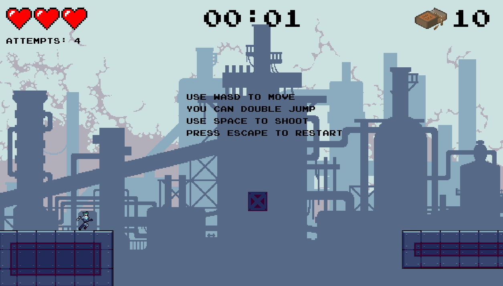
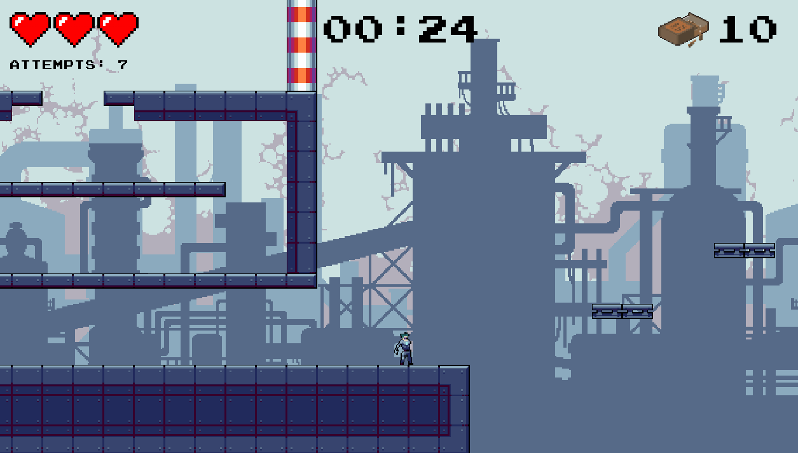

# CyborgPlatform
**Author:** Shuyu Zheng

This is a zombie shooter platformer demo game created as a college project in my first year. Built entirely from scratch using **Java Swing**—no external libraries, game engines, or external assistance involved. All physics, mechanics, and features were hand-coded based on intuition when I was starting to code, so please don’t judge too harshly!

In the game, you navigate a level, avoiding obstacles and zombies and tracking your score. It features:

- **Physics-Based Movement**: Simple gravity and collision detection mechanics made by hand.
- **Zombie Shooter**: Engage with enemies while platforming through the levels.
- **HUD**: Displays health, score, attempts, and a timer.
- **Dynamic Level Loading**: Levels are loaded from a text file, where each character represents a different platform or object type.

Players can configure gameplay preferences (difficulty, theme colour, background music) via a start screen before entering the game, and also see their scores.

All sprites and images are from [CraftPix](https://craftpix.net/freebies/). Big thanks to them for providing these awesome assets for free!

To play, ensure all required image files are organized in the `src` directory as per the setup instructions, and you have download:

- **Java JDK 17** or later
- **JavaFX SDK** compatible with your JDK
- A Java-compatible IDE (e.g. IntelliJ IDEA, Eclipse) or command-line build environment  

then, compile and run the main application entry point `app.GameApp`.

   ```bash
   cd path/to/src
   javac app/GameApp.java
   java app/GameApp
   ```
When executed, the game will launch a start screen where player preferences can be selected.

## Gameplay Preview




## Version History
| Version | Date       | Description                                                                                                                             |
|---------|------------|-----------------------------------------------------------------------------------------------------------------------------------------|
| v1      | 2025-10-24 | Build fixed, game runs successfully. See [Changelog.md](docs/Changelog.md) and screenshot [task1_RunSucc.png](docs/task1_OpenSucc.png). |
| v2      | 2025-12-3  | Refactored to v2 version. See details in [SoftwareDesign.md](docs/SoftwareDesign.md).                                                   |
| v2      | 2025-12-8  | Added Start Screem, collectible and scoring, difficult level functions. See details in [SoftwareDesign.md](docs/SoftwareDesign.md).     |

## Related Document
[Changelog.md](docs/Changelog.md)  
[SoftwareDesign.md](docs/SoftwareDesign.md)  
[Testing](docs/Testing.md)