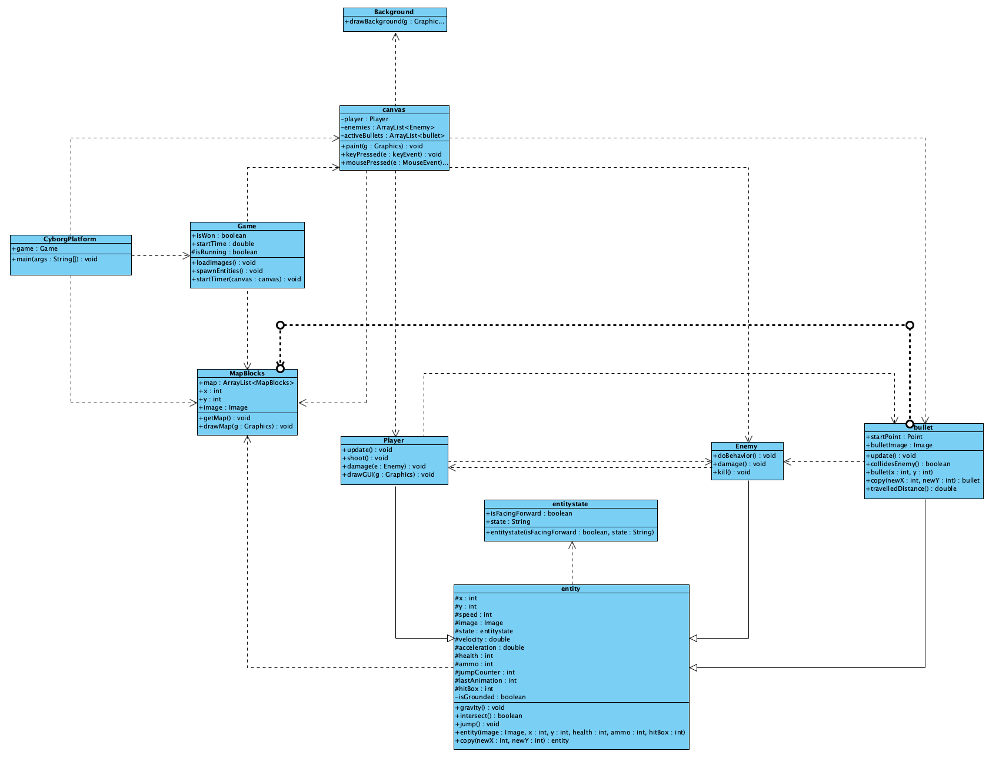
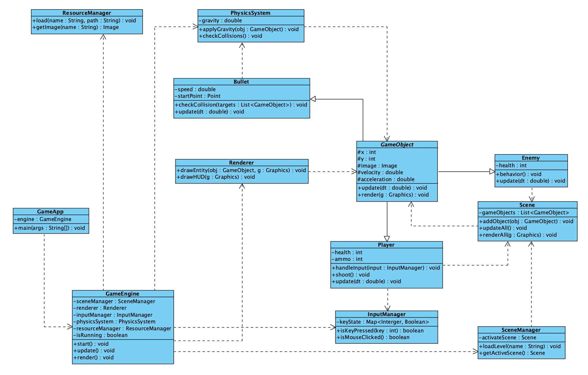
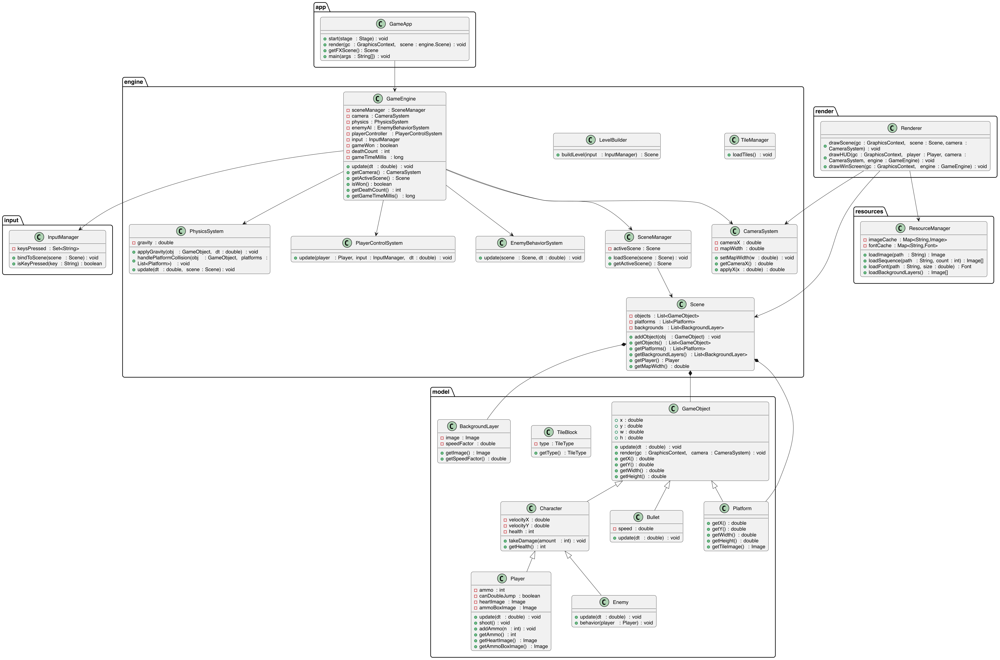
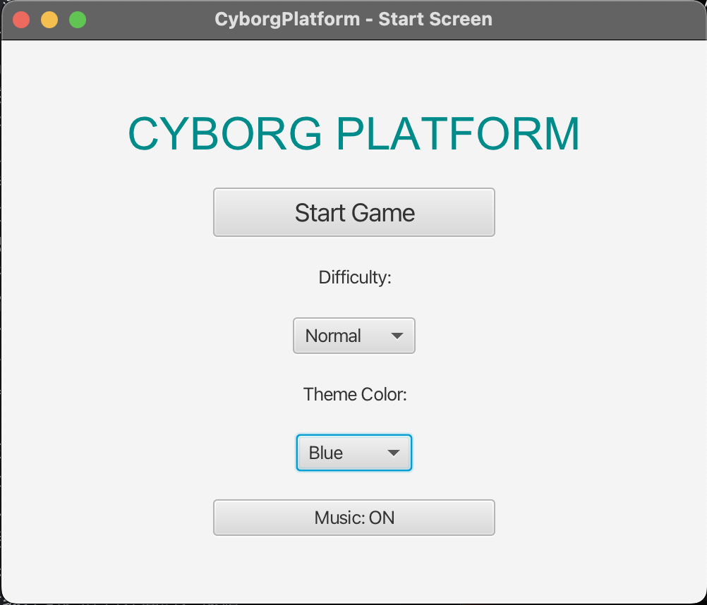
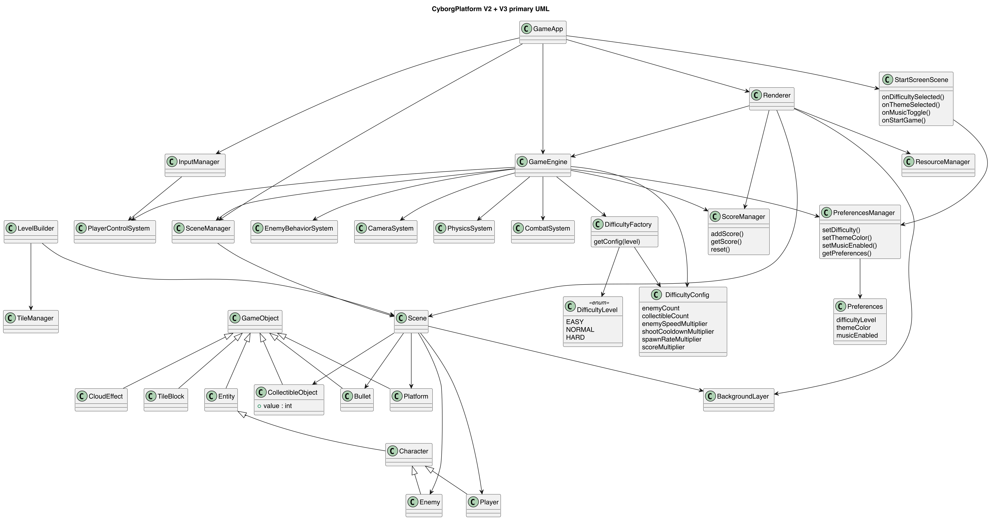

# Version 1

In the current version of the UML design, the entire system 
adopts a relatively centralized architecture, with all game 
logic revolving around a core class - `v1.canvas`. The `v1.Player`, 
`v1.Enemy`, and `v1.bullet` classes are inherited from `v1.entity` class. 
`v1.CyborgPlatform` depends on `v1.Game`, and `v1.Game` depends on 
`v1.canvas`; `v1.canvas` also depends on `v1.Player`, `v1.Enemy`, 
`v1.bullet`, `v1.MapBlocks`, and `v1.Background`.

The program is launched through `v1.CyborgPlatform`, 
which is responsible for creating the window, initializing 
the `v1.Game` object, and adding `v1.canvas` to the window. 
The `v1.Game` class mainly handles resource loading and v1.entity 
generation. `v1.canvas` directly manages all active objects, 
including the player `player`, the list of enemies `enemies`, 
and the list of active bullets `activeBullets`. All game 
entities inherit from the `v1.entity` class, which encapsulates 
common physical behaviors (such as position, velocity, 
gravity, etc.) and collision detection logic. However, 
the `intersect()` method of `v1.entity` directly depends on 
the global static `v1.MapBlocks.map` list to determine if a 
collision with the terrain has occurred. This direct access 
to global resources tightly binds `v1.entity` to the environment 
module, lacking flexibility. During runtime, 
the `v1.Player` class responds to input and creates new `v1.bullet` 
objects, and the bullets then detect collisions with `v1.Enemy`. 
Meanwhile, enemies adjust their behavior based on their 
relative position to the player.

This structure has the following several problems:
1. **Overburdened:** 'v1.canvas' is the control center of the game, responsible for rendering, input event handling, and game status updates. All interactions are scheduled through 'v1.canvas'
2. **High coupling:** Due to the dependency on 'v1.canvas', complex indirect dependency relationships have been formed among various classes
3. **Poor extensibility and Limited reusability**

# Version 2

In the v2 structure, `v2.engine.GameEngine` class is the core 
coordinator responsible for controlling the game loop, 
including updating scenes, processing input, and 
rendering frames. Subsystems such as `v2.render.Renderer` handles 
all drawing operations, `v2.input.InputManager` captures and 
processes player input, `v2.engine.PhysicsSystem` manages gravity 
and collision detection, and `resources.ResourceManager` loads 
and caches game assets such as images. This modular 
organization allows each subsystem to function independently 
while communicating through the engine, reducing direct 
dependencies between gameplay objects.

The game scene itself is managed through `v2.engine.SceneManager`, 
which controls one or more v2.engine.Scene objects. Each scene 
contains a list of `v2.model.GameObject` instances—these represent 
all active elements in the game, including the player, 
enemies, and bullets. The `v2.model.GameObject` class is an abstract 
superclass defining standard methods like `update()` and 
`render()`. The `v1.Player`, `v1.Enemy`, and `Bullet` classes 
all inherit from `v2.model.GameObject` and implement their own 
specific behaviors, such as input handling, movement, 
or collision responses.

The entry class `v2.app.GameApp`, which replace `v1.CyborgPlatform`, 
now only serves to initialize and start the `v2.engine.GameEngine`, 
which takes over full control of execution. This change 
transforms the system from a single tightly bound loop 
into a flexible, event-driven structure. In the updated UML 
diagram, dependencies flow downward from `v1.CyborgPlatform` 
to `v2.engine.GameEngine`, and from the engine to independent 
subsystems like `v2.render.Renderer`, `v2.input.InputManager`, and 
`v2.engine.PhysicsSystem`. The inheritance hierarchy remains clean: 
`v1.Player`, `v1.Enemy`, and `Bullet` extend `v2.model.GameObject`, 
while scenes and managers interact through well-defined 
interfaces. Overall, this refactoring reduces coupling, 
enhances reusability, and makes the system easier to extend.

## How the code be refactored with git commits explanation

### Problems Identified in V1

During the design process of V2, I first conducted an overall analysis of the architecture issues of V1, 
particularly focusing on the severe problem of responsibility stacking and logical confusion within the Game.java, 
Player.java, and Enemy.java classes - a typical "God Object" problem. These classes integrated input processing, 
game logic, collision detection, AI behavior, physics updates, and rendering code. 
Therefore, any modifications had to be made within these large classes, 
which increased the maintenance difficulty and reduced the testability.

### Refactoring Strategy and Key Design Principles in v2

In V2, I adopted the principles of modularization and single responsibility(SRP) to restructure and categorize the entire program. 
The core idea is that **"Data belongs to entities; behavior belongs to systems."**, 
rather than being scattered across multiple objects and methods. 
Below, I will explain the overall reconfiguration approach and reasons in several main directions.

### Evolution of the Code Responsibilities — Eliminating God Classes
In V1, several classes accumulated far too many responsibilities. Such as:

* `Player.java` — which performed physics updates, input inspection, animation state switching, 
* rendering, collision response, and gameplay logic.
* `Enemy.java` — which duplicated much of the physics and movement logic from Player, 
* while also directly embedding AI decisions and rendering.
* `MapBlocks.java` — which combined reading map data, constructing tiles, storing tile locations, 
* and partially handling block collision.

These structures increased coupling，and also created duplicated code.

In V2, these responsibilities were redistributed into single responsibility modules:

* `Player` holds player-specific gameplay attributes such as ammo, input reference, cooldown timers, and animation sets; no longer contains control logic.
* `PlayerControlSystem` handles player movement and input logic.

* `Enemy` stores enemy-specific numeric attributes (idle/running speed ranges, chase limits), animations, and state flags; no longer contains moving logic.
* `EnemyBehaviorSystem` handles enemy behavior logic and aggressiveness parameters.

* `PhysicsSystem` performs gravity, movement, and collision resolution.
* `CombatSystem` handles hit detection and damage.

* `TileManager` reads Map.txt, translates characters into tile types, and instantiates appropriate TileBlock objects.
* `TileBlock` represents a solid environment tile with size, texture, and collision properties.
* `TileType` enum mapping tile characters to textures and dimensions; defines tile height and image.

During the second git commit and push, I added the `PlayerContralSystem` and the`EnemyBehaviorSystem`. 
and separated the movement logic and attributes of players and enemies. This design significantly improves code decoupling and maintainability.
After uploading the complete v2 code, when I was writing tests for v2, I moved the bullet-rewards logic from `Enemy` to `CombatSystem`. (3rd git commit)
I think this is more in line with the principle of single responsibility.

In V2, the construction and lifecycle of a game scene are distributed among a set of collaborating classes, leading to clearer and more modular responsibility separation. 

* `GameApp` JavaFX application entry point; initializes canvas, loads resources, sets up Scene, binds input, and runs the main AnimationTimer loop.
* `GameEngine` main update loop & game state
* `Scene` acts as the container of all objects in a level, including platforms and entities.
* `SceneManager` handles active scene switching
* `BackgroundLayer` describes one parallax background layer with an image and speed coefficient.
* `LevelBuilder` loads level and entities
* `CameraSystem` keeps the camera following player
* `Renderer` draws everything to screen

This new structure distributes responsibilities cleanly across specialized modules, improving extensibility 
(e.g., supporting new levels or scene transitions), maintainability, and testability of the codebase.

In V2, I introduced a layered inheritance model for game entities in the second git commit and push, 
which I think it's the biggest highlight of my design: 

* `Entity` serves as the lowest-level abstraction, defining spatial properties (position and size) and a scene reference common to all objects
* `GameObject` builds on this by introducing dynamic behavioral features such as animation frames, movement speed, and gravity support
* `Character` further generalizes shared biological properties such as health, hurt-state, facing direction, grounded state, and jump counters, 

Thus, `Player` and `Enemy` exist as specialized role-specific data holders without containing behavioral logic themselves.
This structure decouples data from functionality, reduces code duplication. Furthermore, this layered architecture makes 
the system highly extensible for future features—for instance, introducing a helper NPC or adding a shield-type entity 
can be done with minimal effort and without modifying existing core classes.

At the same time, I separated the two-jump `CloudEffect` separately in the second git commit and push. This makes the 
responsibilities of the player class clearer and more single, and also increases the scalability of special effects.

I also separated the `InputManager` separately to make the responsibilities of the class more focused and single.

## Brief description of v2 final structure

The v2 structure adopts a clean modular MVC structure supported by JavaFX, with strict separation of responsibilities 
between packages. This design ensures high maintainability, scalability, and testability.

The overall package structure is as follows:

* **app** – JavaFX entry point (`GameApp`), responsible for initialization, scene binding, and executing the main game loop.
* **engine** – Core runtime logic: update cycle, camera, physics, player control, AI, and scene coordination.
* **model** – Data entities and gameplay objects (e.g., `GameObject`, `Player`, `Enemy`, `Platform`).
* **input** – Handles keyboard state through event-driven collection.
* **render** – Pure view layer; draws the world and HUD, decoupled from gameplay logic.
* **resources** – Asset and font loading + caching.

The v2 final UML is as follows:

Model objects follow a clear inheritance hierarchy:

* `GameObject` (base abstract `Entity`)
  Provides shared attributes (x/y coordinates, width/height), rendering delegation, and bounds handling.
    * `Character`
      Adds animated movement, velocity, acceleration, and health, representing dynamic actors.
        * `Player`
          Introduces player-specific logic (jump state, ammo, hearts, UI images).
        * `Enemy`
          Captures hostile agents with optional simple AI hooks used by `EnemyBehaviorSystem`.
    * `Bullet`
      Not effected by gravity but can implement collision interaction.
    * `Platform`
      Represents solid collision geometry blocks.
        * `TileBlock`
          Lightweight tile model that maps into `Platform`.

This provides polymorphism for movement, collision bounds, and rendering.

Engine systems depend on `Scene`:

* `PhysicsSystem` updates all `GameObject`
* `EnemyBehaviorSystem` reads `Enemy` and `Player` state
* `PlayerControlSystem` queries input from `InputManager`
* `CameraSystem` depends on player position and scene width
* `GameEngine` orchestrates all systems

`Renderer` depends only on: camera position, model state, resource manager, and does **not** depend on physics or game logic.

This architecture significantly improves clarity, allowing future extension (e.g., new enemies, weapons, levels, UI overlays) 
with minimal changes to existing code.

# Version 3

## Overview
New feature include:
1. **Difficulty Levels（难度选择）**
2. **Collectible Objects + 分数系统（地图可收集物体 + 击杀敌人得分 + 结算页显示本局分数）**
3. **Start Screen + Player Preferences（开始界面 + 玩家偏好设置：主题颜色与背景音乐开关）**

## Feature 1 – Difficulty Levels
This feature allows players to choose between EASY, NORMAL, and HARD modes. The difficulty level modifies enemy speed, 
enemy numbers, and potentially score rewards.

### Design Approach - New Classes / Interfaces / Methods
* `DifficultyLevel (enum)` Defines the available game difficulty options: EASY, NORMAL, and HARD.
* `DifficultyConfig` Stores all numeric and behavioural parameters associated with a specific difficulty level.
* `DifficultyFactory` Produces the correct DifficultyConfig based on the selected DifficultyLevel.
* `Preferences` Stores the player’s selected difficulty level from the Start Screen.
* `PreferencesManager` Exposes a getter that allows GameEngine to retrieve the chosen difficulty when initialization begins.
* `GameEngine.applyDifficulty()` Applies the DifficultyConfig’s parameters to all relevant gameplay systems.

### Process flow
When the player launches the game, they first enter the Start Screen. On this screen, the player may choose between Easy, 
Normal, and Hard using dedicated difficulty selection buttons. Once selected, the chosen DifficultyLevel is saved into the 
PreferencesManager. After the player presses “Start Game,” GameEngine retrieves the stored difficulty setting and uses 
DifficultyFactory to construct the corresponding DifficultyConfig, which contains all gameplay parameters for that difficulty mode. 
GameEngine then calls applyDifficulty(), distributing these parameters to systems such as enemy spawning, movement behaviour, 
collectible generation, shooting cooldown handling, and score calculations. As a result, the entire gameplay experience—including 
enemy behaviour, item distribution, challenge intensity, and scoring—automatically adjusts based on the player's chosen difficulty. 
The difficulty choice thus flows seamlessly from UI selection → preference storage → configuration generation → gameplay adaptation.

### Differences Between Difficulty Modes

| Difficulty | Enemy Number | Collectible Number | Enemy Speed |    Shooting Cooldown | Ammo Number |
|------------|-------------:|-------------------:|------------:|---------------------:|------------:|
| Easy       |            5 |                  5 |        0.8× | 0.9× (faster firing) |          20 |
| Normal     |           13 |                 10 |        1.0× |                 1.0× |          10 |
| Hard       |           17 |                 15 |        1.3× | 1.2× (slower firing) |          10 | 

**preliminary design, for reference only**
In Easy mode, players face fewer enemies, slower enemy movement, faster shooting cooldowns, and more ammo, 
making the overall experience more forgiving. Normal mode uses baseline parameters to provide a balanced, 
standard challenge. Hard mode significantly increases the number of enemies and collectibles, accelerates enemy speed, 
lengthens the player’s shooting cooldown, resulting in a faster-paced and more demanding experience.

## Feature 2 – Collectible Objects + In-Memory Score  
The game will introduce collectible objects placed on the map. These objects increase the player’s score upon collection. 
Score will also increase upon successful enemy kills. Importantly, score is not persisted locally — it exists only during 
one play session and is displayed on the end-screen.

### Design Approach - New Classes / Interfaces / Methods
* `CollectibleObject` Represents an in-game reward object placed on the map that the player can collect.
* `CollectibleSpawner` Responsible for spawning collectible items at the beginning of the level.
* `ScoreManager` Maintains and updates the player's score throughout the entire gameplay session.
* `ScoreDisplay` Displays the current score in the in-game HUD.
* `Player.collect()` Handles the interaction when the player touches a collectible.
* `Enemy.onDefeated()` It awards points to the player whenever an enemy is destroyed.

### Process flow
When the game loads a level, the GameEngine uses the active DifficultyConfig to determine how many collectibles should be spawned. 
The CollectibleSpawner then generates these items and places them into the scene. During gameplay, the CollisionSystem 
continuously checks whether the player is overlapping with any CollectibleObject. Once a collision is detected, the system 
triggers a collection event: the collectible is removed from the scene and ScoreManager.addScore() is called to award 
points to the player. Similarly, when the player defeats an enemy, Enemy.onDefeated() is triggered, which also awards 
points through the ScoreManager.

Throughout the game, ScoreDisplay retrieves the current score from ScoreManager and updates the HUD, ensuring the player 
receives real-time feedback. The score exists only in memory and is not saved externally; after the player completes the 
level and reaches the victory screen, the final score is displayed based on the ScoreManager’s state.

### Score Awarding  
- Kill enemy → +10  
- Collect item → +5  

## Feature 3 – Start Screen + Player Preferences  

Before entering the game, a start screen is presented with:

- **difficulty Selection** Dropdown selector, default normal
- **theme color selection** Dropdown selector, default BLUE
- **toggle background music** ON/OFF toggle switch, default ON
- **start game button** Standard clickable button

### Design Approach - New Classes / Interfaces / Methods
* `StartScreenScene` Renders the Start Screen UI and captures player inputs, then updates PreferencesManager.
* `Preferences` Stores the player’s chosen settings for the current session.
* `PreferencesManager` Provides setter methods for updates coming from the Start Screen.
* `Renderer.applyThemeColor()` Applies the selected theme color to UI components.
* `MusicPlayer.applyPreference()` Reads `musicEnabled` from Preferences and either plays or mutes the background music accordingly.
* `GameEngine.initFromPreferences()` Central entry point for applying player preferences when the game starts.

### Process flow
When the player enters the Start Screen, they are presented with four interactive settings: the Start Game button, 
a difficulty dropdown menu (defaulting to Normal), a theme color selection group, and a music ON/OFF toggle. Any change 
made by the player—such as selecting a different difficulty, choosing a new theme color, or switching the music 
setting—immediately updates the stored preferences through PreferencesManager. Once the player presses the Start Game button, 
the system invokes GameEngine.initFromPreferences(), which reads the stored preferences and configures the game accordingly. 
Difficulty settings are translated into a DifficultyConfig via DifficultyFactory, theme colors are applied to the UI 
through the Renderer, and MusicPlayer adjusts background music playback based on the music toggle. After these preferences 
are applied, the player is transitioned into the main game scene, where the gameplay experience reflects all choices made 
in the Start Screen. 

## UML

The UML diagram highlights the new V3 components integrated into the existing architecture. The difficulty system introduces 
DifficultyLevel, DifficultyFactory, and DifficultyConfig, where the factory produces configuration objects that GameEngine 
applies during initialization. CollectibleObject extends the GameObject hierarchy and interacts with the scoring system 
through ScoreManager, which handles all score updates displayed by the Renderer. Player preferences are managed through 
Preferences and PreferencesManager, while StartScreenScene collects user selections such as difficulty, theme color, 
and music settings. GameEngine retrieves these preferences via initFromPreferences() to configure gameplay and UI. 
Overall, the V3 additions extend the system through modular, non-intrusive components that plug cleanly into the existing engine.

## Revised (v3)

### Overview
Version 3 of the system introduces a Start Screen with Player Preferences, alongside a systematic refactoring of difficulty 
handling, scoring, collectibles (designed as coin), and audio management. The primary design objective of this iteration is to improve 
separation of concerns, reduce architectural coupling, and ensure that configuration logic is cleanly decoupled from 
core gameplay logic. All changes adhere to MVC principles and follow SOLID, DRY, KISS, and CUPID design guidelines.

### Architectural Refactoring and MVC Alignment
The system architecture is structured around a clear separation between:
* Model: gameplay state and configuration (`Scene`, `Player`, `DifficultyConfig`, `Preferences`)
* View: JavaFX UI and rendering (`StartScreenScene`, `Renderer`)
* Controller / Engine: orchestration of gameplay updates (`GameEngine`, subsystem managers)
Player preferences such as difficulty level, theme color, and music settings are no longer hard-coded or embedded inside 
engine logic. Instead, these are captured at application startup via a dedicated Start Screen and stored in a central 
preferences model. This refactoring eliminates previous code smells such as long conditional blocks, hidden dependencies, 
and configuration leakage into gameplay classes.

### Start Screen and Preferences Management
A new `StartScreenScene` was introduced to allow players to select:
* Difficulty level (Easy / Normal / Hard)
* Theme color
* Background music ON/OFF
To support this, a lightweight Preferences subsystem was designed:
* `Preferences` acts as a simple data holder for runtime user choices.
* `PreferencesManager` provides controlled, static access to update and retrieve preferences during the startup phase.
This design follows the Single Responsibility Principle: UI components only update preferences, while the application 
layer decides how those preferences are applied.

### Difficulty Configuration Strategy
Difficulty-dependent gameplay behaviour is encapsulated using a Factory Pattern:
* `DifficultyFactory` translates a `DifficultyLevel` enum into a `DifficultyConfig`    
* `DifficultyConfig` defines all tunable parameters, including enemy count, enemy speed multiplier, initial ammo, reward 
scaling, firing cooldown, and score multiplier
This ensures that no gameplay class needs to "know" about difficulty modes explicitly. All core systems instead consume 
values derived from `DifficultyConfig`, enabling easier extension and eliminating duplicated conditional logic.

### Scene-Centric Game State Ownership
The `Scene` was refactored to become the authoritative owner of:
* Active game objects (include coin)
* Score management
* Difficulty configuration
This change removed the need for external systems to track global state, reduced coupling between engine subsystems, and 
aligned object lifecycle management with the game world container. Responsibility is localized, improving cohesion and testability.

### Audio Management Design
Background music support was added using a dedicated `MusicPlayer` service implemented as a Singleton. Music playback is 
treated as an application-level concern, not part of the game engine. Player preferences determine whether music is enabled, 
and this preference is applied once during game startup.

This design avoids polluting core gameplay logic with platform-specific concerns and respects the Open–Closed Principle 
by allowing audio behaviour to change without modifying engine code.

### Rendering and Theme Customisation
Theme color selection is applied dynamically through the rendering layer. The Renderer exposes a single configuration 
method to update UI color styles based on user preferences. Rendering logic remains stateless with respect to preferences, 
further enforcing MVC separation.